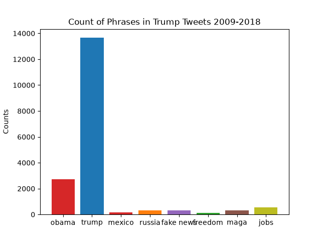

# [lab-web-data](https://csci40.rtealwitter.com/topics/05_web_scraping/lab.html)

This is a table that shows the number of times each phrase was written in Trump's tweets from 2009-2018. It also shows that as a percentage of the total number of words in all tweets. 
| Phrase | Count | Percent |
|--------|-------|---------|
| obama | 2738 | 07.73 |
| trump | 13659 | 38.58 |
| mexico | 159 | 00.45 |
| russia | 323 | 00.91 |
| fake news | 311 | 00.88 |
| freedom | 107 | 00.30 |
| maga | 330 | 00.93 |
| jobs | 562 | 01.59 |

This is a bar chart that shows the count of certain phrases across all of Trump's tweets from 2009-2018. I predicted that "freedom" would be the phrase that is tweeted the most, but in trump fashion, his own name has the most mentions throughout his tweets.
